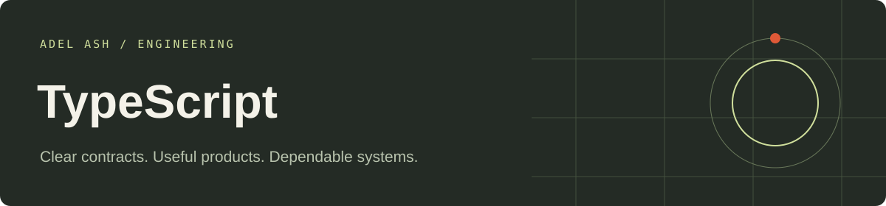

# TypeScript Engineering

Runnable portfolio applications with explicit business rules, browser interfaces and automated checks. Each application has its own folder. All shared source needed by these projects lives inside this repository.

| Application | Folder |
| --- | --- |
| [Ecommerce Fulfillment and Component Portal](typescript/ecommerce-fulfillment-and-component-portal-typescript) | `typescript/ecommerce-fulfillment-and-component-portal-typescript` |
| [Financial Reconciliation and Approval Workbench](typescript/financial-reconciliation-and-approval-workbench-typescript) | `typescript/financial-reconciliation-and-approval-workbench-typescript` |
| [Education Learning and Assessment Portal](typescript/education-learning-and-assessment-portal-typescript) | `typescript/education-learning-and-assessment-portal-typescript` |

## Setup and verification

# TypeScript / NestJS demos

Node 22+ and pnpm. From this folder: `pnpm install --frozen-lockfile`, `pnpm build`, `pnpm test`, then `pnpm start ecommerce-fulfillment-and-component-portal-typescript/project.json`. Substitute either finance or education project folder. Open `http://127.0.0.1:8000` for the console. `PORT` changes the port.

For the React interface: start the API, then from `../frontends/react` run `pnpm install --frozen-lockfile` and `pnpm dev`. Vite proxies `/api` to this local API. The same interface supports all three configurations, with typed controls, role selection, request feedback and audit views.

Implemented: TypeScript, NestJS, runtime boundary validation, native HMAC signatures, synchronous in-memory transactions, outbox fixture retries, approval permissions and version conflicts. Node tests cover failure behavior and simultaneous request attempts. PostgreSQL/Prisma, Redis, MongoDB, Apollo/GraphQL and Kafka are not configured in these local demo versions. All tokens are explicitly local role fixtures. Restart resets data.

Signed callback example from this folder: `pnpm exec tsx -e "const {Engine}=require('./src/engine'); const p={id:'p',invoice:'INV-100',amount:10000}; console.log(JSON.stringify({...p,signature:new Engine().signature(p)}))"`.

## Repository guide

- Application READMEs include launch commands, sample inputs and workflow details.
- Architecture documents describe storage and failure boundaries.
- GitHub Actions runs stack-specific checks on changes.
- Local roles and sample records are development examples. Keep them on localhost; configure trusted identity, secrets and operational controls for any public deployment.

## Portfolio

[View this stack’s work](https://adelash.vercel.app/typescript) · [Email Adel Ash](mailto:adelash.work@gmail.com)
